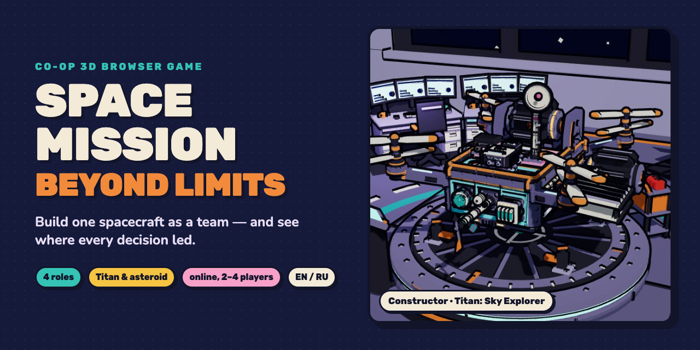
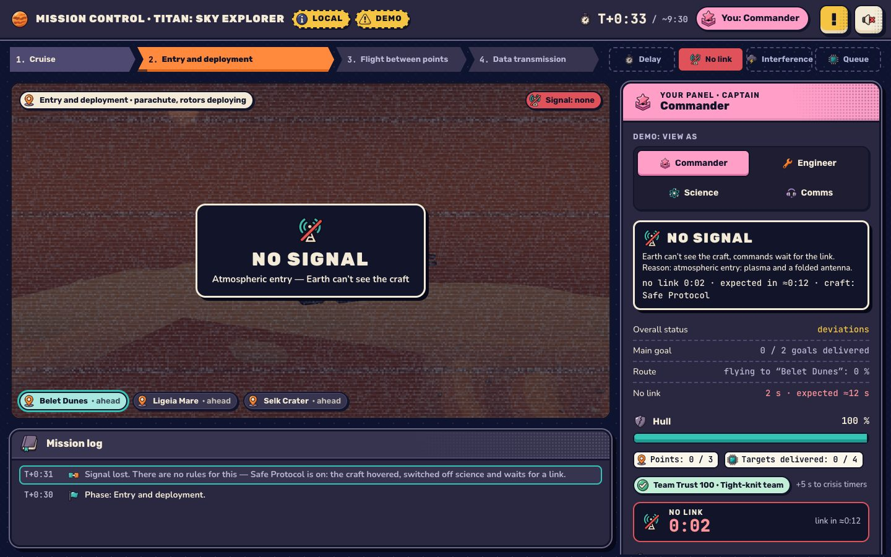
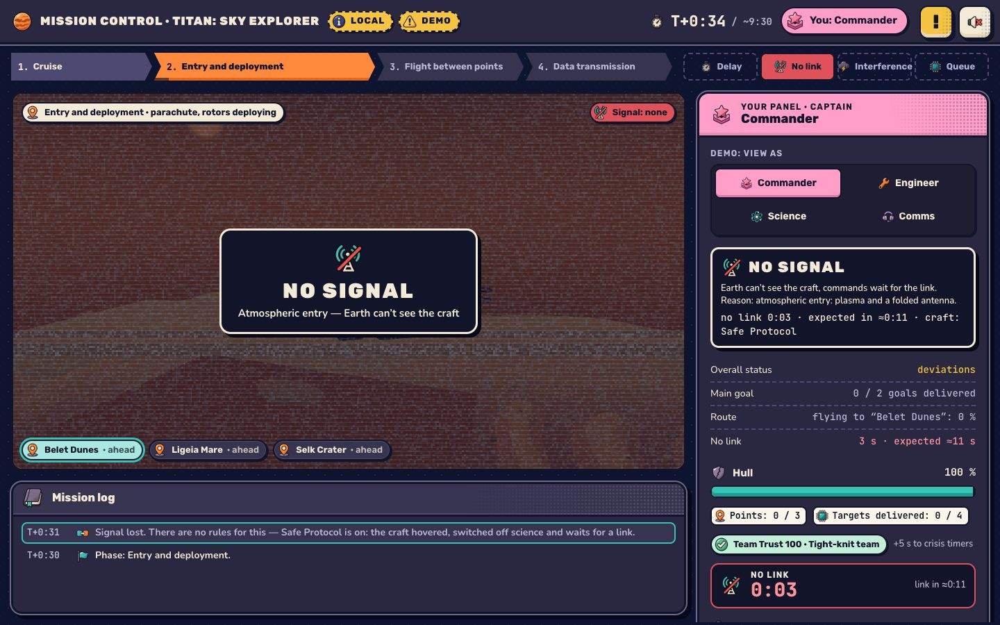
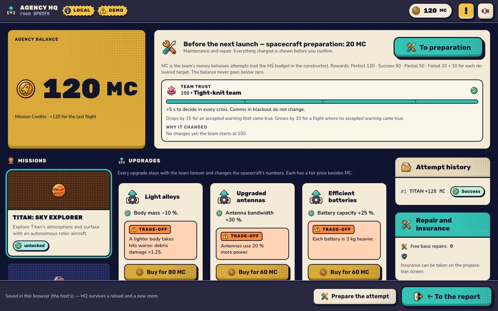
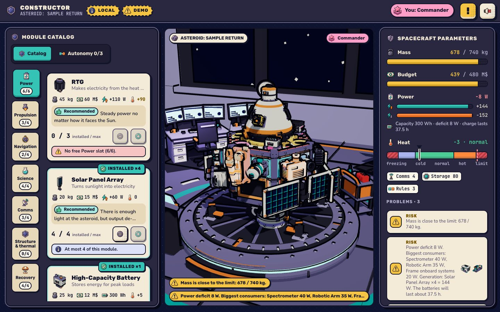
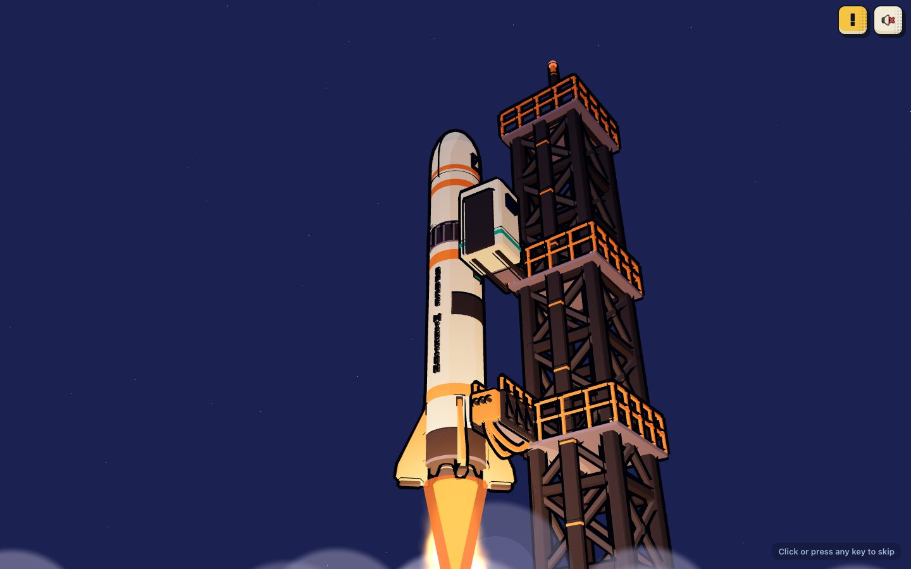
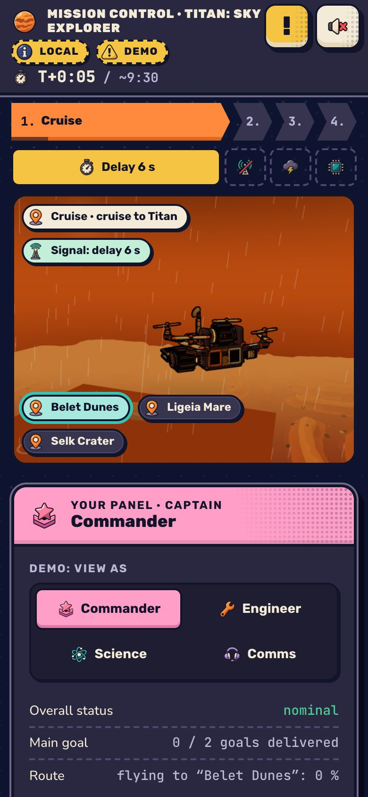
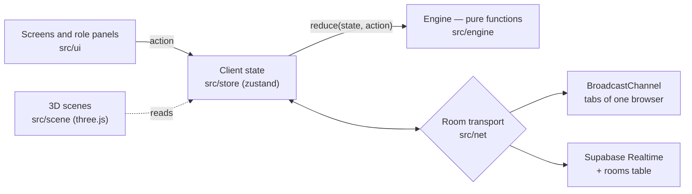

<p align="center">
  
</p>

<p align="center">
  <a href="https://space-mission-tau.vercel.app"><b>▶ Play online</b></a>
  &nbsp;·&nbsp; <a href="#how-to-play">How to play</a>
  &nbsp;·&nbsp; <a href="#spec-compliance">Spec compliance</a>
  &nbsp;·&nbsp; <a href="#how-it-works">How it works</a>
  &nbsp;·&nbsp; <a href="docs/README.md">Docs</a>
</p>

<p align="center">
  <a href="https://github.com/emil2ka/space-mission-beyond-limits/actions/workflows/ci.yml"></a>
  
  
  
  
  
</p>

# Space Mission: Beyond Limits

**A co-op educational 3D browser game for 2–4 players.** The players are a space agency team. Each one runs a department and sees only part of the data, but every decision changes **one shared spacecraft**. The team builds the craft within mass, budget, power and heat limits, launches it to Titan or to an asteroid, and handles failures and signal loss together.

The game never fixes mistakes for the players. It warns about a risk and leaves the team the right to take it, and the final report shows **which decision led to what**.

> Built from the spec "SPACE MISSION: BEYOND LIMITS" v2.0. The spec's core principle — "a working cause-and-effect system first, visual polish second" — is also the order the game was built in: first a tested simulation engine, then 3D and the interface.

<table>
  <tr>
    <td width="50%"><br /><sub><b>Constructor.</b> Catalog by department, several copies of a module, live mass, budget, power and heat.</sub></td>
    <td width="50%"><br /><sub><b>Mission Control.</b> Flight phases, waypoints, delayed signal, your role's panel.</sub></td>
  </tr>
  <tr>
    <td><br /><sub><b>Crisis.</b> A timer and a decision for each role; with no decision, an autonomy rule kicks in.</sub></td>
    <td><br /><sub><b>Blackout.</b> Earth can't see the craft — the onboard If–Then rules take over, and each role sees something different.</sub></td>
  </tr>
  <tr>
    <td><br /><sub><b>Report.</b> Outcome, score, Team Trust, a mission replay and "decision → consequence" chains.</sub></td>
    <td><br /><sub><b>HQ.</b> Credits, repairs, insurance and upgrades with an honest trade-off.</sub></td>
  </tr>
  <tr>
    <td><br /><sub><b>Second mission — the asteroid.</b> Different limits: vacuum, fuel, a robotic arm, a return capsule.</sub></td>
    <td><br /><sub><b>Launch.</b> A 3D launch sequence before the flight.</sub></td>
  </tr>
</table>

<p align="center"><br /><sub>Phone: 3D on top, the role panel below, no horizontal scrolling.</sub></p>

## How to play

1. Open **https://space-mission-tau.vercel.app**, enter your name and press **"Create a room"**.
2. Send the 6-character room code to your team. The others enter it on their own devices — 2 to 4 players.
3. Everyone picks a role, the host picks a mission. Then: briefing → budget and building → role tasks and If–Then rules → readiness check, the commander approves or sends it back → launch → flight with crises → report → HQ.

**Solo:** "Demo mode: play solo" puts all roles in one tab with a "view as" switch. Demo mode is clearly labelled as a demo and never passed off as multiplayer.

The game is in **English and Russian** — each player picks their own language.

## Roles

| Role | Responsible for | What they do |
|---|---|---|
| **Commander** | strategy, budget, risk | splits the budget, approves the configuration or vetoes it, makes the calls during failures; Team Trust drops only when a clearly shown warning was knowingly ignored |
| **Chief Engineer** | power, mass, heat, reliability | builds the craft, sees the exact source of a power deficit, routes power, isolates and repairs parts |
| **Science Officer** | instruments, data, the sample | picks and calibrates instruments, decides between more data with a risk of overheating or a safer pace |
| **Communications Officer** | antenna, signal, memory | points the antenna, orders the packet queue, decides what to keep when memory is full |

## Missions

| | **Titan: Sky Explorer** | **Asteroid: Sample Return** |
|---|---|---|
| Goal | an autonomous rotorcraft studies Titan's atmosphere and surface | rendezvous, take a sample, seal it and return the capsule to Earth |
| Power | solar panels are almost useless — the main source is the RTG | enough sunlight, but orientation and manoeuvres matter |
| Movement | rotors in a dense atmosphere | rotors don't work in a vacuum — chemical engines and thrusters; the ion engine is not for sharp manoeuvres |
| Risks | cold, methane storms, signal delay, a blackout on entry | fuel, debris, a jammed arm, choosing the sampling site |

## Spec compliance

### Acceptance tests (§15)

| Test | What it checks | Status | Verified by |
|---|---|---|---|
| **A — Titan power** | a solar panel gives almost nothing, each RTG adds generation (and mass, cost, heat), batteries add capacity, not generation; the cause of a deficit is shown | ✅ | [`acceptance.test.ts`](src/engine/__tests__/acceptance.test.ts), [`energy.test.ts`](src/engine/__tests__/energy.test.ts), browser |
| **B — incompatibility** | a rotor on the asteroid does not count as propulsion, and the game explains why | ✅ | [`acceptance.test.ts`](src/engine/__tests__/acceptance.test.ts), browser |
| **C — chain of consequences** | a heavy module → mass and cost → an over-limit warning → veto or approval on record → the report links the overload to its consequences | ✅ | [`acceptance.test.ts`](src/engine/__tests__/acceptance.test.ts), [`flight.test.ts`](src/engine/__tests__/flight.test.ts), browser |
| **D — blackout** | roles see different data, tactical radio, antenna and packet queue, engineer diagnostics, timer and hull for the commander, the autonomy rules fire when the timer runs out | ✅ | [`blackout.test.ts`](src/engine/__tests__/blackout.test.ts), browser |
| **E — economy** | credits for Titan, the asteroid's price and unlock, repairs before the next launch, no negative balance and no soft-lock | ✅ | [`economy.test.ts`](src/engine/__tests__/economy.test.ts), browser |
| **F — multiplayer** | 4 clients in one room, unique roles, everyone sees changes, a player drops and returns with the state kept | ✅ | [`multiplayer.test.ts`](src/engine/__tests__/multiplayer.test.ts), [`transport.test.ts`](src/net/__tests__/transport.test.ts); 4 tabs locally, 2 players online via Supabase |

### MVP priorities (§1)

- **P0 — all done:** rooms, roles, two missions, catalog, builder, mass / power / budget calculation, launch, events, report.
- **P1 — all done:** real online multiplayer (Supabase Realtime), If–Then Planner, blackout with asymmetric screens, tactical radio, HQ economy.
- **P2 — partly:** role mini-games and complex 3D animations are in; extra missions and blueprints are not.

### Definition of done (§16)

The whole path from creating a room to the final report can be played on both missions with no dead ends. The missions differ in mechanics · the catalog is split into departments · several copies of a module are allowed within slots, mass and budget · batteries are not counted as generators · decisions affect several systems at once · every role has its own useful actions · the blackout is tied to the autonomy rules · the economy is explainable · the report teaches through mistakes.

### Where it differs from the spec

- **Full 3D instead of 2D illustrations** — you see modules on the hull, overheating and failures in the scene ([decision 0002](docs/06%20Decisions/0002%20Full%203D%20with%20animations.md)).
- **2–4 players instead of exactly 4** — free roles are taken by someone on the team ([decision 0013](docs/06%20Decisions/0013%20Roles%20tasks%20trust%20players%20language.md)).
- **English and Russian** — each player picks their own language.
- Balance numbers are game parameters, not real NASA specifications ([balance table](docs/03%20Design/Balance%20Table.md)).

## How it works



- **All game logic lives in `src/engine/`** as pure functions with no React or three.js: catalog, mass / budget / power / heat, If–Then rules, flight, crises, economy, report. That is why it can be tested without a browser.
- **Host authority** ([decision 0004](docs/06%20Decisions/0004%20Host%20authority.md)): the host applies players' actions and broadcasts the state. If the host disappears, the next online player becomes host after 10 s.
- **Deterministic crises** ([decision 0006](docs/06%20Decisions/0006%20Deterministic%20crises.md)): every failure has a cause in the build or the craft's state (overloaded bus, heat, no shield…), with only a little random noise. That's why the report can honestly say "this happened because of X".
- **Without Supabase keys** the game runs in a local demo mode and says so.
- **3D models** are glTF, validated and optimized by scripts (`gltf-transform`, `meshoptimizer`), cel-shaded with outlines; moving parts are animated in code. Graphics Auto / Low / High; the heavy 3D chunks load after you join a room.

## Run locally

You need Node.js 22+ and pnpm.

```bash
pnpm install
pnpm dev
```

It opens at `http://localhost:5173`. Without keys it runs in local mode: every browser tab is a separate player.

| Command | What it does |
|---|---|
| `pnpm test` | all tests (Vitest) |
| `pnpm typecheck` | TypeScript type check |
| `pnpm build` | production build into `dist/` |
| `pnpm dev:lan` | dev server reachable from a phone on the same Wi-Fi |

**Online mode:** create a Supabase project, run [`supabase/schema.sql`](supabase/schema.sql) in the SQL Editor, copy `.env.example` to `.env.local` and fill in the project URL and the publishable key. Step by step — [Multiplayer.md](docs/04%20Tech/Multiplayer.md).

## Tests

**269 tests in 21 files**, run by CI on every push:

- **engine** — spec acceptance tests A–F, power, Titan and asteroid flights, blackout, If–Then rules, role tasks, economy, mission replay, multiplayer;
- **3D** — model contract (nodes, slots, triangle budgets), mechanics of moving parts, graphics quality selection;
- **translations** — English and Russian have the same keys, all data is translated;
- **network and audio** — room saving, sound events.

## Repository layout

| Path | What's there |
|---|---|
| `src/engine/` | simulation: catalog and mission data, calculations, flight, crises, economy, report |
| `src/ui/` | screens, role panels, UI kit |
| `src/scene/` | 3D scenes: test stand, launch, Titan, asteroid, return |
| `src/net/` | room transport: local and Supabase |
| `src/store/` | client state |
| `src/audio/` | sound, synthesized in code |
| `src/i18n/` | English and Russian |
| `public/models/` | optimized 3D models (GLB) |
| `scripts/` | model validation and optimization, module icon rendering, device measurements |
| `supabase/` | database schema for online mode |
| `docs/` | documentation: [game design, tech, decisions](docs/README.md) |

## Honest status

- Multiplayer was tested in 4 tabs (local transport) and with 2 players online via Supabase. **A full four-player flight on separate devices has not been run yet.**
- Phones and weak laptops were tested in emulation (CPU slowed 4–6×, software rendering), not on real school devices.
- The Low graphics setting has no comic outlines — a trade-off for FPS on phones.
- More in [Known Issues](docs/04%20Tech/Known%20Issues.md).

## Use of AI

Made with AI tools from our briefs:

- **3D models** — spacecraft and modules, the rocket, the astronaut, HQ, Titan and the asteroid (Claude Design);
- **interface and icons** — screen design, the UI kit (Claude Design), 62 icons (ChatGPT);
- **concept art** — style options and spacecraft hull concepts (ChatGPT);
- **texts and translation** — game texts, the English version and the documentation (Claude).

**Our team:** key decisions (full 3D, style, roles and rules), choosing between options, and testing.

The same is shown in the game itself — behind the yellow **"!"** button in the top-right corner.

## Tech stack

React 19 · TypeScript · Vite · three.js + @react-three/fiber + drei · zustand · Supabase Realtime · Vitest · glTF-Transform + meshoptimizer

## License

Code — [MIT](LICENSE). The 3D models, icons and images were made for this project and are used only in it.
