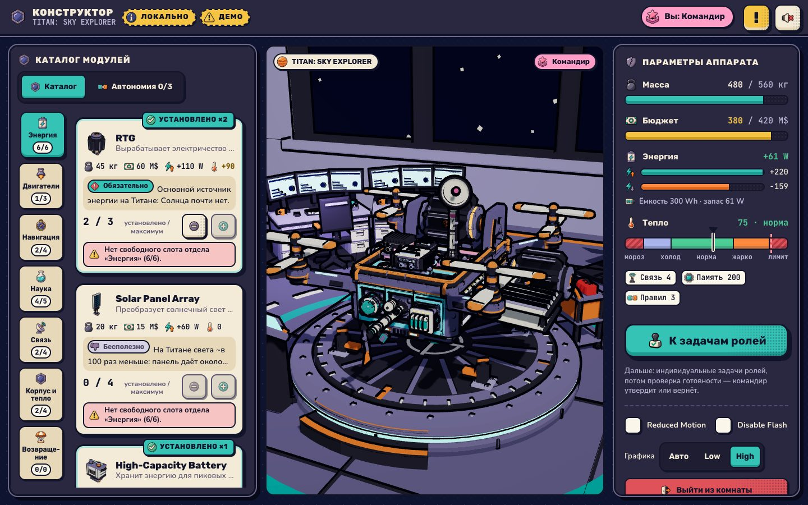
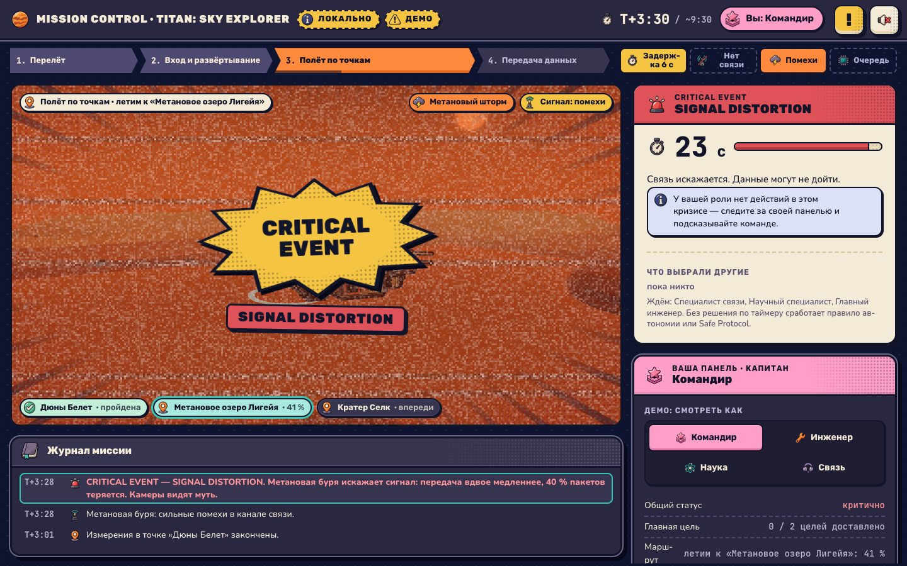
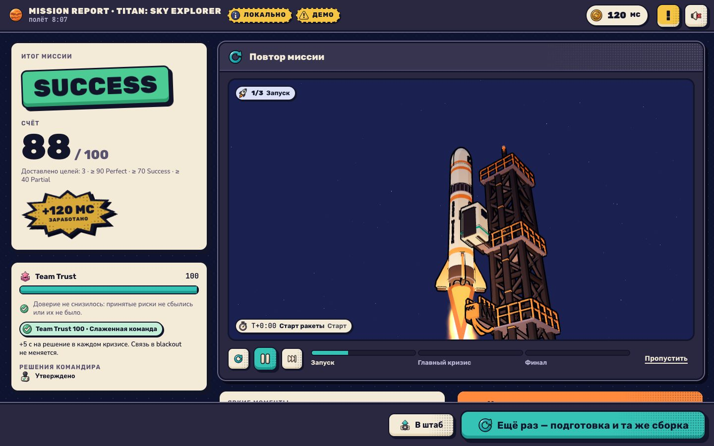
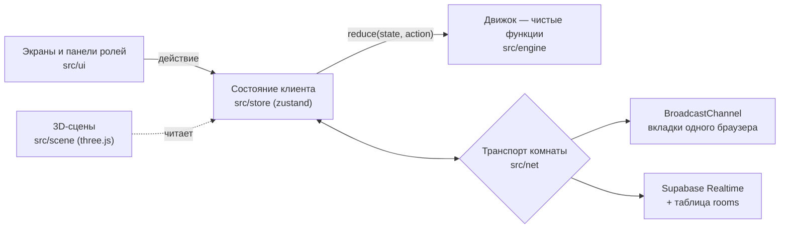

<p align="center">
  
</p>

<p align="center">
  <a href="https://space-mission-tau.vercel.app"><b>▶ Играть онлайн</b></a>
  &nbsp;·&nbsp; <a href="#как-сыграть">Как сыграть</a>
  &nbsp;·&nbsp; <a href="#соответствие-тз">Соответствие ТЗ</a>
  &nbsp;·&nbsp; <a href="#как-устроено">Как устроено</a>
  &nbsp;·&nbsp; <a href="docs/README.md">Документация</a>
</p>

<p align="center">
  <a href="https://github.com/emil2ka/space-mission-beyond-limits/actions/workflows/ci.yml"></a>
  
  
  
  
  
</p>

# Space Mission: Beyond Limits

**Кооперативная образовательная 3D-игра в браузере для 2–4 игроков.** Игроки — команда космического агентства. Каждый ведёт свой отдел и видит свою часть данных, но все решения меняют **один общий аппарат**. Команда собирает аппарат, укладывается в массу, бюджет, энергию и тепло, запускает его на Титан или к астероиду и вместе разбирается с авариями и потерей связи.

Игра не исправляет ошибки за игроков. Она предупреждает о риске и оставляет команде право его принять, а итоговый отчёт показывает, **какое решение к чему привело**.

> Сделано по ТЗ «SPACE MISSION: BEYOND LIMITS» v2.0. Главный принцип ТЗ — «сначала работающая причинно-следственная система, затем визуальная полировка» — и есть порядок, в котором строилась игра: сначала движок с тестами, потом 3D и интерфейс.

<table>
  <tr>
    <td width="50%"><br /><sub><b>Конструктор.</b> Каталог по отделам, несколько экземпляров модулей, живой расчёт массы, бюджета, энергии и тепла.</sub></td>
    <td width="50%"><br /><sub><b>Mission Control.</b> Полёт по фазам, точки маршрута, связь с задержкой, панель своей роли.</sub></td>
  </tr>
  <tr>
    <td><br /><sub><b>Кризис.</b> Таймер, решение каждой роли, без решения срабатывает автономное правило.</sub></td>
    <td><br /><sub><b>Blackout.</b> Земля не видит аппарат — работает бортовой алгоритм If–Then, роли видят разное.</sub></td>
  </tr>
  <tr>
    <td><br /><sub><b>Отчёт.</b> Итог, счёт, Team Trust, повтор миссии и цепочки «решение → последствие».</sub></td>
    <td><br /><sub><b>Штаб.</b> Кредиты, ремонт, страховка и улучшения с честной ценой.</sub></td>
  </tr>
  <tr>
    <td><br /><sub><b>Вторая миссия — астероид.</b> Другие ограничения: вакуум, топливо, манипулятор, капсула возврата.</sub></td>
    <td><br /><sub><b>Запуск.</b> 3D-ролик старта перед полётом.</sub></td>
  </tr>
</table>

<p align="center"><br /><sub>Телефон: 3D сверху, панель роли снизу, без горизонтальной прокрутки.</sub></p>

## Как сыграть

1. Откройте **https://space-mission-tau.vercel.app**, введите имя и нажмите **«Создать комнату»**.
2. Отправьте команде 6-значный код комнаты. Остальные вводят его на своих устройствах — от 2 до 4 игроков.
3. Каждый выбирает роль, хост выбирает миссию. Дальше: брифинг → бюджет и сборка аппарата → задачи ролей и правила If–Then → проверка готовности, утверждение или вето командира → запуск → полёт с кризисами → отчёт → штаб.

**Одному:** кнопка «Демо-режим» — все роли в одной вкладке, переключение «смотреть как». Режим честно помечен плашкой «ДЕМО», это не выдаётся за мультиплеер.

## Роли

| Роль | За что отвечает | Что делает |
|---|---|---|
| **Командир** | стратегия, бюджет, риски | распределяет бюджет, утверждает конфигурацию или накладывает вето, принимает решения в авариях; Team Trust падает только за сознательно проигнорированное предупреждение |
| **Главный инженер** | энергия, масса, тепло, надёжность | собирает аппарат, видит точный источник дефицита энергии, распределяет питание, изолирует и чинит узлы |
| **Научный специалист** | приборы, данные, образец | выбирает и калибрует приборы, решает: больше данных с риском перегрева или осторожнее |
| **Специалист связи** | антенна, сигнал, память | наводит антенну, выбирает очередь пакетов, решает, что сохранить, когда память заполнена |

## Миссии

| | **Titan: Sky Explorer** | **Asteroid: Sample Return** |
|---|---|---|
| Цель | автономный роторный аппарат исследует атмосферу и поверхность | сблизиться, взять образец, упаковать и вернуть капсулу на Землю |
| Энергия | солнечные панели почти бесполезны — основной источник RTG | Солнца достаточно, но ориентация и манёвры решают |
| Движение | роторы в плотной атмосфере | роторы не работают в вакууме — химические двигатели и двигатели малой тяги, ионный не для резких манёвров |
| Риски | холод, метановые бури, задержка связи, blackout при входе | топливо, обломки, заклинивание манипулятора, выбор места забора |

## Соответствие ТЗ

### Приёмочные тесты (§15)

| Тест | Что проверяет | Статус | Чем проверено |
|---|---|---|---|
| **A — энергетика Титана** | панель почти ничего не даёт, каждый RTG добавляет генерацию (и массу, цену, тепло), батареи добавляют ёмкость, а не генерацию; показана причина дефицита | ✅ | [`acceptance.test.ts`](src/engine/__tests__/acceptance.test.ts), [`energy.test.ts`](src/engine/__tests__/energy.test.ts), браузер |
| **B — несовместимость** | ротор на астероиде не засчитывается как двигатель, игра объясняет почему | ✅ | [`acceptance.test.ts`](src/engine/__tests__/acceptance.test.ts), браузер |
| **C — цепочка последствий** | тяжёлый модуль → масса и цена → предупреждение о лимите → вето или утверждение с записью → отчёт связывает перегруз с последствиями | ✅ | [`acceptance.test.ts`](src/engine/__tests__/acceptance.test.ts), [`flight.test.ts`](src/engine/__tests__/flight.test.ts), браузер |
| **D — blackout** | роли видят разное, тактическое радио, антенна и очередь пакетов, диагностика инженера, таймер и корпус у командира, по таймеру срабатывает автономный алгоритм | ✅ | [`blackout.test.ts`](src/engine/__tests__/blackout.test.ts), браузер |
| **E — экономика** | кредиты за Титан, цена и разблокировка астероида, ремонт до следующего запуска, без отрицательного баланса и тупиков | ✅ | [`economy.test.ts`](src/engine/__tests__/economy.test.ts), браузер |
| **F — мультиплеер** | 4 клиента в одной комнате, уникальные роли, все видят изменения, отключение и возврат с сохранением состояния | ✅ | [`multiplayer.test.ts`](src/engine/__tests__/multiplayer.test.ts), [`transport.test.ts`](src/net/__tests__/transport.test.ts); 4 вкладки локально, 2 игрока онлайн через Supabase |

### Приоритеты MVP (§1)

- **P0 — всё:** комнаты, роли, две миссии, каталог, конструктор, расчёт массы, энергии и бюджета, запуск, события, отчёт.
- **P1 — всё:** настоящий онлайн-мультиплеер (Supabase Realtime), If–Then Planner, blackout с асимметрией экранов, тактическое радио, экономика штаба.
- **P2 — частично:** мини-игры ролей и сложные 3D-анимации есть; дополнительных миссий и чертежей нет.

### Критерий готовности (§16)

Путь от создания комнаты до итогового отчёта проходится без тупиков на обеих миссиях. Миссии отличаются механиками · каталог разделён на отделы · несколько экземпляров модулей в пределах слотов, массы и бюджета · батареи не считаются генераторами · решения влияют на несколько систем сразу · у каждой роли свои полезные действия · blackout связан с автономным алгоритмом · экономика объяснима · отчёт учит на ошибках.

### Чем отличается от ТЗ

- **Полноценное 3D вместо 2D-иллюстраций** — модули видно на корпусе, перегрев и аварии видно в сцене ([решение 0002](docs/06%20Decisions/0002%20Full%203D%20with%20animations.md)).
- **2–4 игрока вместо ровно 4** — свободные роли берёт кто-то из команды ([решение 0013](docs/06%20Decisions/0013%20Roles%20tasks%20trust%20players%20language.md)).
- **Русский и английский** — язык свой у каждого игрока.
- Числа баланса — условные игровые параметры, а не реальные характеристики NASA ([таблица баланса](docs/03%20Design/Balance%20Table.md)).

## Как устроено



- **Вся игровая логика — в `src/engine/`** как чистые функции без React и three.js: каталог, расчёт массы, бюджета, энергии и тепла, правила If–Then, полёт, кризисы, экономика, отчёт. Поэтому её можно проверять тестами без браузера.
- **Авторитет хоста** ([решение 0004](docs/06%20Decisions/0004%20Host%20authority.md)): хост применяет действия игроков и рассылает состояние. Если хост пропал, через 10 с хостом становится следующий игрок в сети.
- **Детерминированные кризисы** ([решение 0006](docs/06%20Decisions/0006%20Deterministic%20crises.md)): у каждой аварии есть причина в сборке или состоянии аппарата (перегрузка шины, тепло, нет щита…), случайность — только небольшой шум. Поэтому отчёт может честно сказать «это случилось из-за X».
- **Без ключей Supabase** игра работает в локальном демо-режиме и честно это показывает.
- **3D-модели** — glTF, проверка и оптимизация скриптами (`gltf-transform`, `meshoptimizer`), cel-shading с обводкой, подвижные части анимируются кодом. Графика Авто / Low / High, тяжёлые 3D-чанки грузятся после входа в комнату.

## Запуск локально

Нужны Node.js 22+ и pnpm.

```bash
pnpm install
pnpm dev
```

Откроется `http://localhost:5173`. Без ключей — локальный режим: каждая вкладка браузера — отдельный игрок.

| Команда | Что делает |
|---|---|
| `pnpm test` | все тесты (Vitest) |
| `pnpm typecheck` | проверка типов TypeScript |
| `pnpm build` | production-сборка в `dist/` |
| `pnpm dev:lan` | dev-сервер, доступный с телефона в той же Wi-Fi-сети |

**Онлайн-режим:** создайте проект Supabase, выполните [`supabase/schema.sql`](supabase/schema.sql) в SQL Editor, скопируйте `.env.example` в `.env.local` и впишите URL проекта и publishable-ключ. Пошагово — [Multiplayer.md](docs/04%20Tech/Multiplayer.md).

## Тесты

**269 тестов в 21 файле**, проходят в CI на каждый пуш:

- **движок** — приёмочные тесты ТЗ A–F, энергия, полёт Титана и астероида, blackout, правила If–Then, задачи ролей, экономика, повтор миссии, мультиплеер;
- **3D** — контракт моделей (узлы, слоты, бюджеты треугольников), механика подвижных частей, выбор качества графики;
- **переводы** — у русского и английского одинаковые ключи, все данные переведены;
- **сеть и звук** — сохранение комнаты, события звука.

## Структура

| Путь | Что там |
|---|---|
| `src/engine/` | симуляция: данные каталога и миссий, расчёты, полёт, кризисы, экономика, отчёт |
| `src/ui/` | экраны, панели ролей, UI-кит |
| `src/scene/` | 3D-сцены: стенд, запуск, Титан, астероид, возвращение |
| `src/net/` | транспорт комнаты: локальный и Supabase |
| `src/store/` | состояние клиента |
| `src/audio/` | звук, синтезируется в коде |
| `src/i18n/` | русский и английский |
| `public/models/` | оптимизированные 3D-модели (GLB) |
| `scripts/` | проверка и оптимизация моделей, рендер иконок модулей, замеры на устройствах |
| `supabase/` | схема базы для онлайн-режима |
| `docs/` | документация: [геймдизайн, техника, решения](docs/README.md) |

## Честно о статусе

- Мультиплеер проверен в 4 вкладках (локальный транспорт) и с 2 игроками онлайн через Supabase. **Полный полёт вчетвером на разных устройствах ещё не проводился.**
- Телефоны и слабые ноутбуки проверены в эмуляции (замедление процессора в 4–6 раз, программный рендер). На реальных школьных устройствах — нет.
- На графике Low нет комикс-обводок — это размен ради FPS на телефонах.
- Остальное — в [Known Issues](docs/04%20Tech/Known%20Issues.md).

## Использование ИИ

С помощью ИИ-инструментов по нашим заданиям сделаны:

- **3D-модели** — аппараты и модули, ракета, астронавт, штаб, Титан и астероид (Claude Design);
- **интерфейс и иконки** — дизайн экранов, UI-кит (Claude Design), 62 иконки (ChatGPT);
- **концепт-арт** — варианты стиля и концепты корпусов аппаратов (ChatGPT);
- **тексты и перевод** — тексты игры, английская версия и документация (Claude).

**Наша команда:** ключевые решения (полноценное 3D, стиль, роли и правила), отбор вариантов и тестирование.

То же самое написано в самой игре — под жёлтой кнопкой **«!»** в правом верхнем углу.

## Технологии

React 19 · TypeScript · Vite · three.js + @react-three/fiber + drei · zustand · Supabase Realtime · Vitest · glTF-Transform + meshoptimizer

## Лицензия

Код — [MIT](LICENSE). 3D-модели, иконки и изображения сделаны для этого проекта и используются только в нём.

---

<sub>**English.** *Space Mission: Beyond Limits* is a co-op educational 3D browser game for 2–4 players: a space agency team builds one shared spacecraft, flies it to Titan or an asteroid, handles crises and signal blackouts, and gets a report that links every decision to its consequences. Play at https://space-mission-tau.vercel.app (RU/EN). Run locally with `pnpm install && pnpm dev`; tests with `pnpm test`.</sub>
